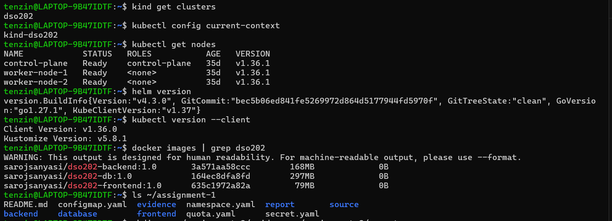
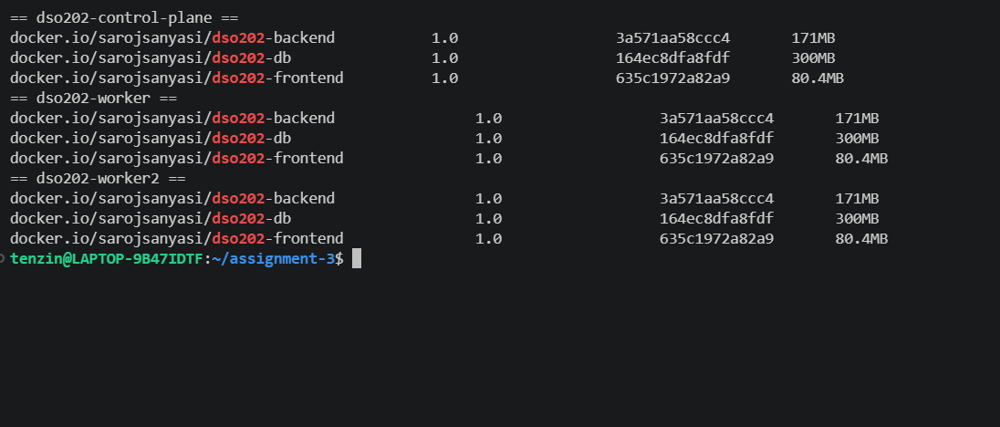

# DSO202 Assignment 3: Task Tracker with Kustomize and Helm

In this assignment I deployed my Assignment 1 Task Tracker app again, but this time with the two configuration management tools from the Unit 4 notes, Kustomize and Helm, instead of applying each YAML file one by one with `kubectl apply -f`. It is the same three tier app as Assignment 1: a PostgreSQL database, a backend API and a frontend page, with the same images, the same ConfigMap and Secret values (apart from CORS_ORIGIN in dev), and the same ResourceQuota and LimitRange. With each tool I deployed a dev version and a prod version from one shared source.

The full write up for each tool, with screenshots and the problems I ran into, is in the two reports linked at the end of this page.

## Repository layout

```text
assignment-3/
├── kustomize/
│   ├── base/                  Assignment 1 manifests, shared by every environment
│   │   ├── kustomization.yaml
│   │   ├── config.env         input for configMapGenerator
│   │   ├── secret.env         input for secretGenerator (class dummy values)
│   │   ├── quota.yaml         ResourceQuota and LimitRange
│   │   └── database/ backend/ frontend/
│   └── overlays/
│       ├── dev/               namespace, labels, replicas, CORS merge
│       └── prod/              namespace, labels, replicas, four patches
├── helm/
│   ├── task-tracker/          the chart
│   │   ├── Chart.yaml, values.yaml, values.schema.json, .helmignore
│   │   └── templates/         11 objects, _helpers.tpl, NOTES.txt, tests/
│   ├── environments/          dev.yaml and prod.yaml
│   └── packages/              task-tracker-0.1.0.tgz
├── evidence/                  screenshots
└── report/
```

## Running it

Kustomize:

```bash
kubectl kustomize kustomize/overlays/dev       # render first
kubectl diff -k kustomize/overlays/dev         # preview (the namespace must exist)
kubectl apply -k kustomize/overlays/dev        # deploy
kubectl delete -k kustomize/overlays/dev       # clean up
```

Helm:

```bash
helm lint ./helm/task-tracker -f helm/environments/dev.yaml
helm install task-tracker-dev ./helm/task-tracker -f helm/environments/dev.yaml \
  -n dso202-a3-helm-dev --create-namespace --wait
helm test task-tracker-dev -n dso202-a3-helm-dev --logs
helm uninstall task-tracker-dev -n dso202-a3-helm-dev
```

The tutor's images are published for arm64 only, so like in Assignment 1 I used my own builds of the same images, already loaded into the kind nodes. To open the frontend in a browser, the backend needs a port forward (`kubectl port-forward svc/backend-svc 8080:8080 -n <namespace>`), because the page calls `backend-svc:8080` and my Windows hosts file points that name at my laptop, the same setup as Assignment 1.

## Environment

My kind cluster, Helm v4.3.0 and Kustomize v5.8.1 (built into kubectl) were all ready, and the three images were already inside every kind node.





## Reports

- [Kustomize report](report/kustomize-report.md): base, dev and prod overlays, generators, the name hash rollout, strategic merge and JSON 6902 patches, problems and fixes
- [Helm report](report/helm-report.md): the chart, validation, dev and prod releases, upgrade, the values pitfall, rollback, helm test, packaging, problems and fixes

## Kustomize and Helm side by side

| | Kustomize | Helm |
| --- | --- | --- |
| How dev and prod differ | overlays with patches on plain YAML | one chart with a values file per environment |
| Config change triggers a rollout | name hash on the generated ConfigMap and Secret | checksum annotation on the Pod template |
| Removing a field in prod | JSON 6902 `remove` | `if` in the template, `nodePort: null` in values |
| Checking before deploying | render and `kubectl diff -k` | lint, template, schema, server side dry run, then `helm test` |
| History and rollback | none, revert the files and apply again | numbered revisions and `helm rollback` |
| Clean removal | `delete -k`, including the namespace in the overlay | `helm uninstall`, the namespace stays |
| Sharing | a Git folder | a versioned `.tgz` package |

Both tools deployed the same app with the same dev and prod settings, except that Helm dev ends with 2 backend replicas after my upgrade. Kustomize felt simpler for my own manifests, since the base stays plain YAML that I can apply directly. Helm took more setup, but it gave me validation, a release history, one command rollback and a package I could share.
