# DSO202 Assignment 3 Report: Helm

This report covers Part B of Assignment 3, where I packaged my Assignment 1 Task Tracker app as a Helm chart, following the Unit 4 Helm notes (Unit III 3.2). I wrote one chart, `task-tracker`, and installed it twice as two releases, dev and prod, each with its own values file. Then I went through the release lifecycle from the notes: validate, install, inspect, test, upgrade, roll back, package and uninstall.

## The chart

`Chart.yaml` keeps the chart version (`0.1.0`) separate from the app version (`1.0`, the image tag). `values.yaml` holds the settings that change between environments, with the Assignment 1 numbers as defaults, and `_helpers.tpl` holds the shared labels plus a `required` check, so the chart refuses to render until an environment is chosen.

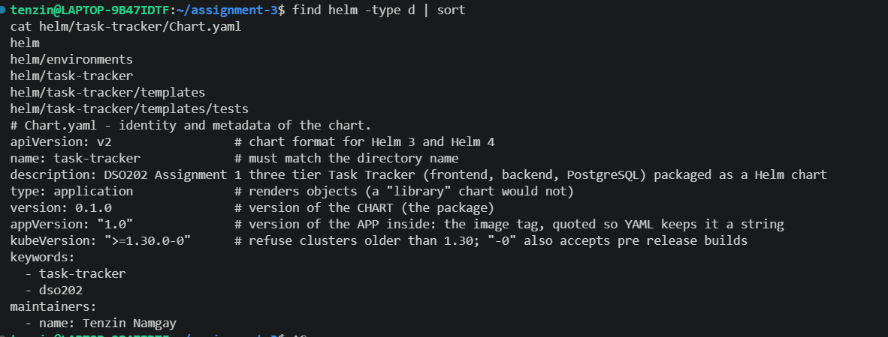

The ConfigMap and Secret are built from values. One `dbName` value fills both `DB_NAME` and `POSTGRES_DB`, and one user and password fill both the `DB_*` and `POSTGRES_*` keys, so the backend and the database can never disagree, which I had to keep matching by hand in Assignment 1. Each Deployment has a checksum annotation of the rendered ConfigMap, and the backend and database also have one for the Secret, so a config change rolls out new Pods. That is the Helm version of the Kustomize name hash. I also added the release name to the selectors, next to the Assignment 1 app and tier labels, so two releases never select the Pods of the other release.

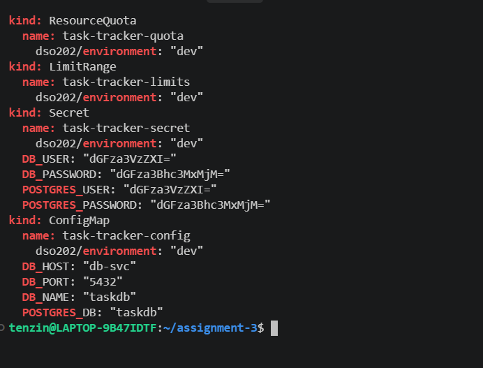
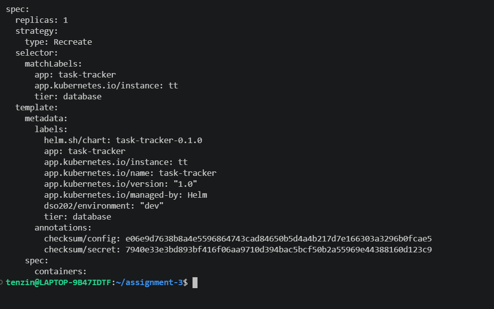
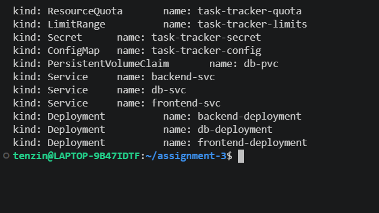

The frontend Service only writes `nodePort` when the type is NodePort, so the same template gives NodePort 30080 in dev and ClusterIP in prod. The test Pod for `helm test` only runs when I ask for it, because of its `helm.sh/hook: test` annotation.

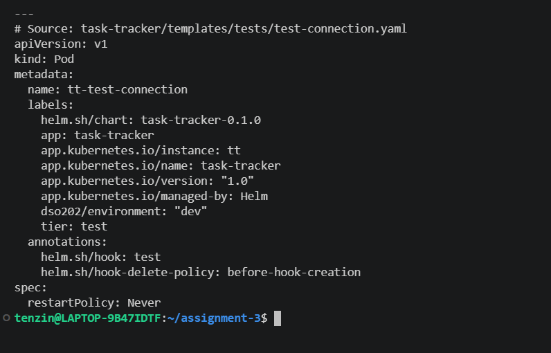

## Checking before installing

`helm lint` and `helm template` passed for both environment files. Then I tried three bad inputs on purpose: no environment, wrong values, and an unquoted image tag `1.30`, which YAML reads as the number 1.3. The `required` check and `values.schema.json` stopped all of them before anything was rendered. Last, I sent the rendered chart to the API server as a server side dry run, the only one of these checks that catches a misspelled Kubernetes field.

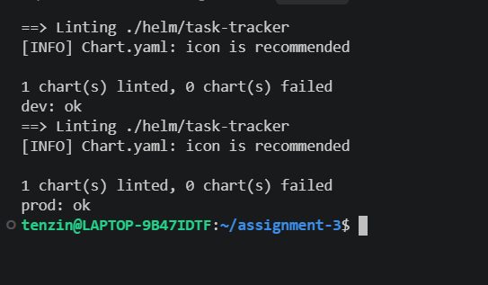
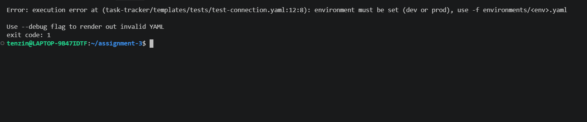
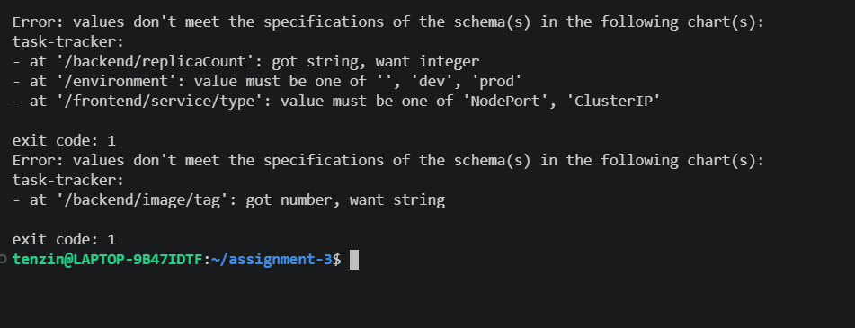
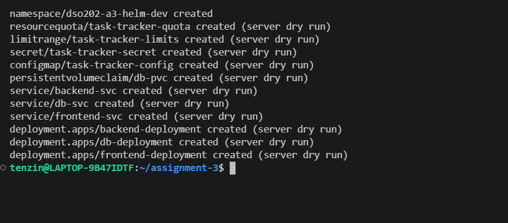

## Dev release

I installed the chart as the release `task-tracker-dev`. The NOTES printed the right instructions for a NodePort frontend. `helm get values` showed only what came from `dev.yaml`, `helm get manifest` showed which template made each object, and Helm stored the release record as the Secret `sh.helm.release.v1.task-tracker-dev.v1`.

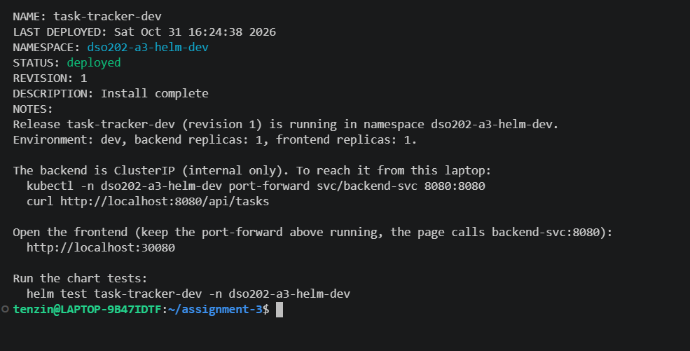
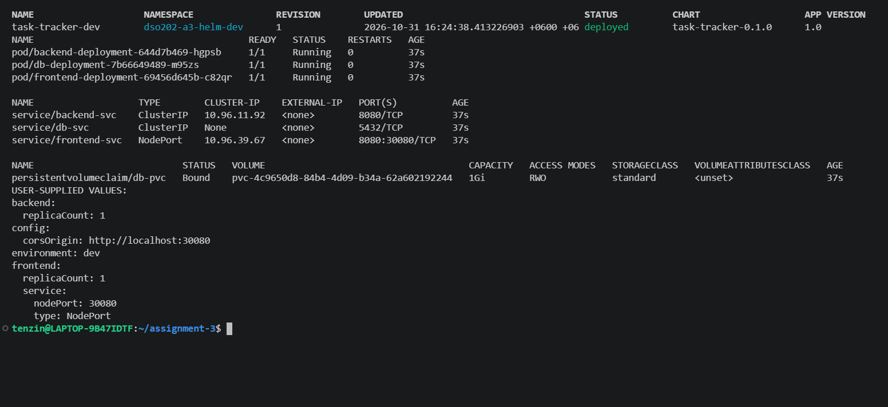
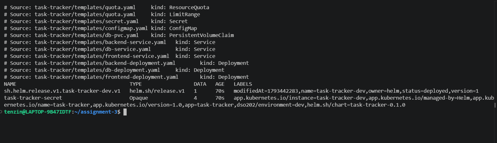

`helm test` ran the test Pod, which checked the backend API and the frontend page from inside the cluster. Then I checked the real page in the browser through a port forward to the backend.

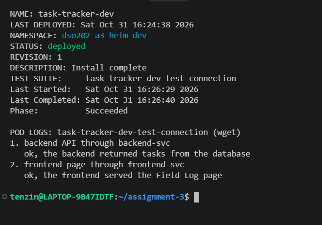
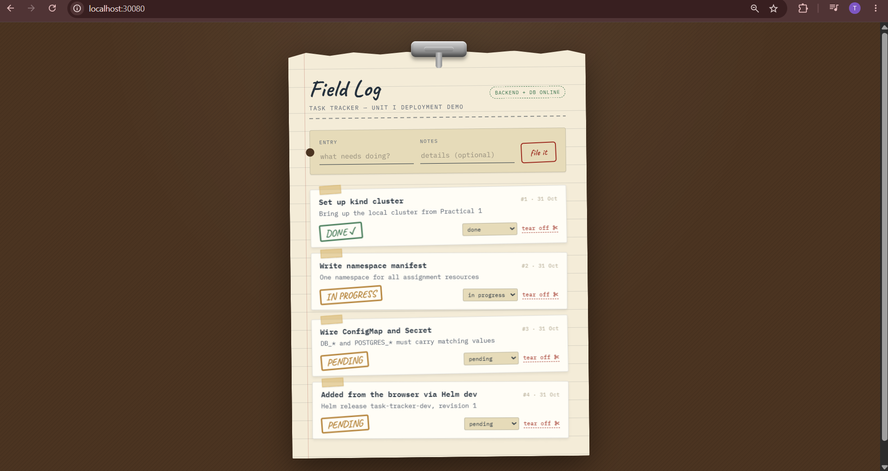

## Upgrade, the values pitfall and rollback

Revision 2 scaled the backend to 2 replicas by changing `dev.yaml` and passing the whole file again, which is the right way to upgrade. For revision 3 I repeated the mistake from the notes on purpose: an upgrade with only `--set environment=dev`. Helm said "Upgrade complete", but it silently dropped everything from `dev.yaml`, so `CORS_ORIGIN` went back to `*` and the backend back to 1 replica. One `helm rollback task-tracker-dev 2` restored everything as revision 4, and the history still shows all four revisions. `dev.yaml` in the repo has `replicaCount: 2` from that upgrade.

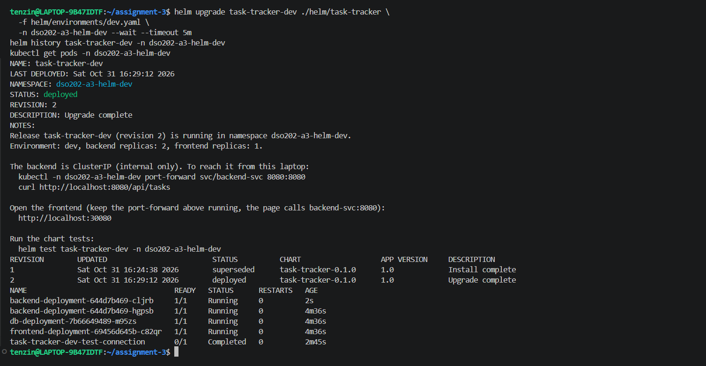
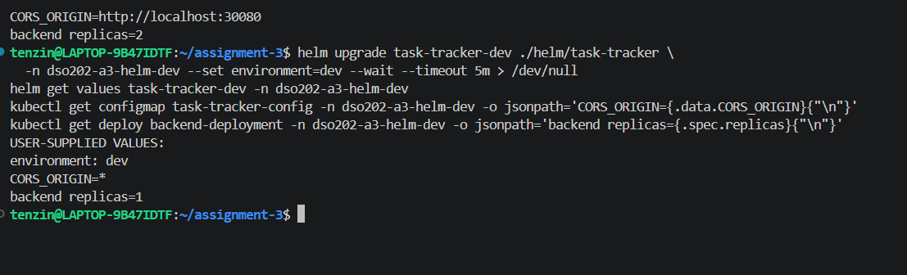
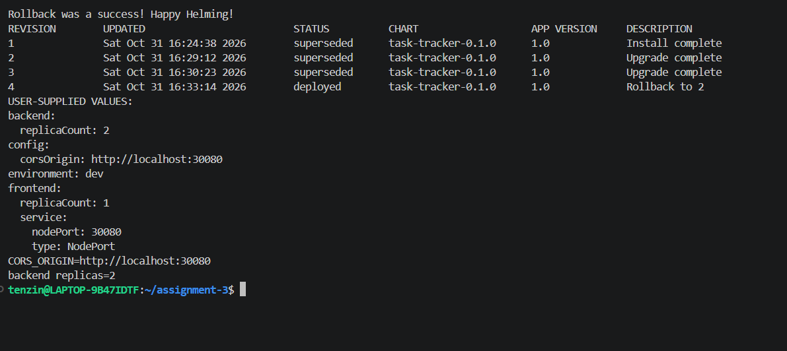

All Pods were replaced during revisions 3 and 4, but `helm test` still passed and task #4 was still on the page. The new Pods even came back with the same ReplicaSet hashes as revision 2, since revision 4 is an exact copy of it. The rollback only reapplied the manifests, it did not touch the data on the PVC.

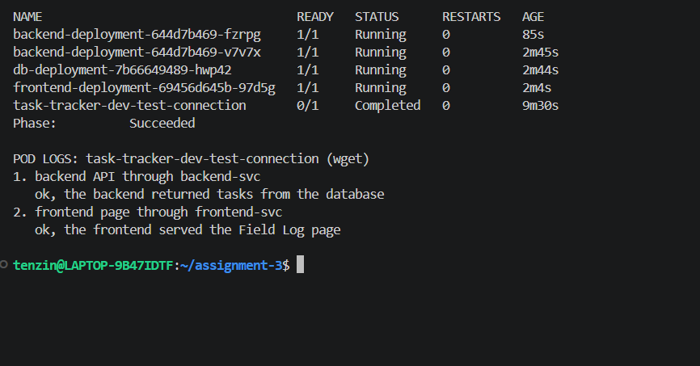
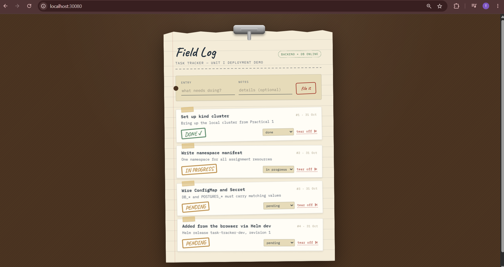

## Prod release

The same chart with `prod.yaml` gave the release `task-tracker-prod`: 2 backend and 2 frontend replicas, bigger backend resources, a bigger quota and a ClusterIP frontend. The NOTES switched to the ClusterIP instructions by themselves, and the live numbers match the Kustomize prod overlay exactly.

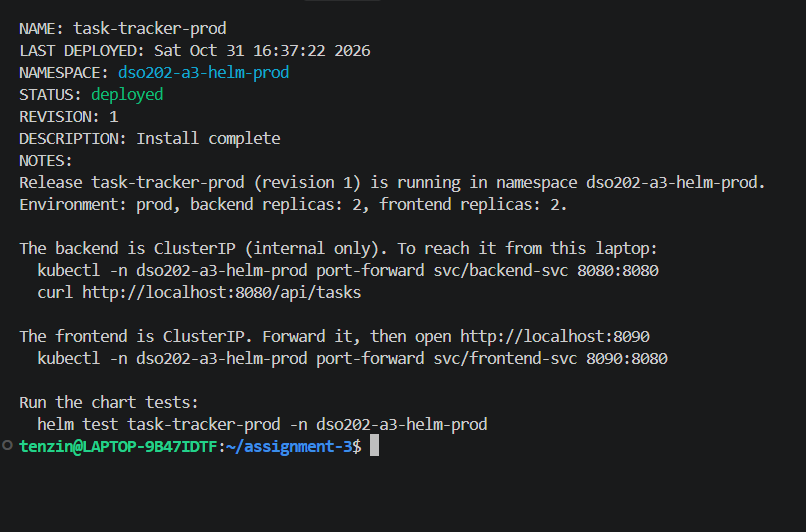
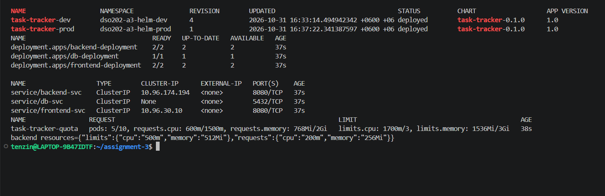
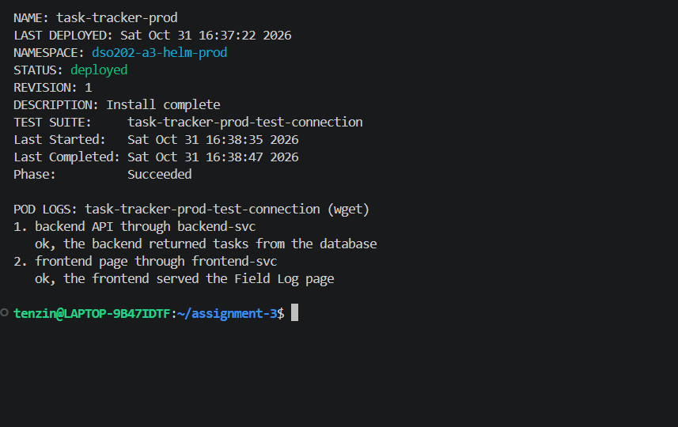

## Packaging and uninstall

`helm package` packed the chart into one 5.5 KB file, `task-tracker-0.1.0.tgz`, and rendering from that file gave the same objects, so that one file is all someone else would need. `helm uninstall` removed both releases and their release records, and I deleted the namespaces afterwards.

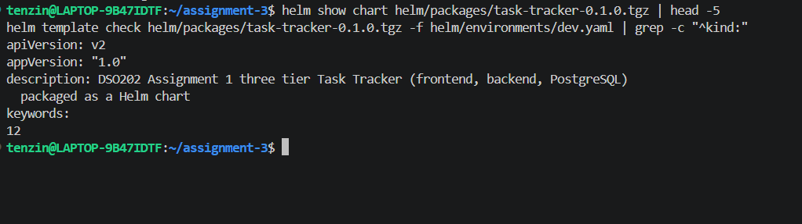
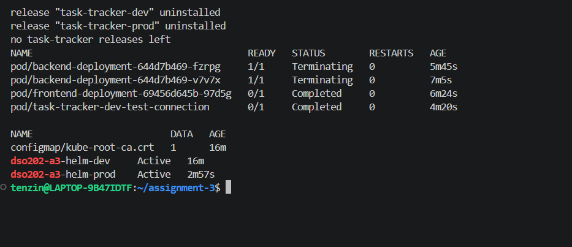
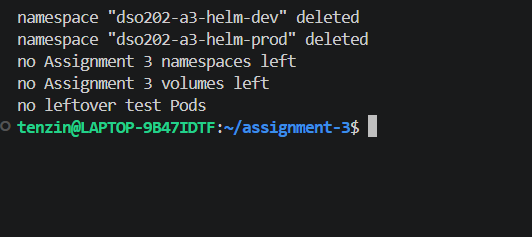

## Problems I ran into and how I solved them

**The backend Deployment was missing from the chart.** When I rendered the full chart, it showed 10 objects instead of 11. Rendering only `templates/backend-deployment.yaml` said the template could not be found, so the file had never been created because my paste had failed. I created it again and the render showed all 11 objects. Counting the rendered objects is what caught it.

**The test Pod example from the notes would not fit my LimitRange.** The notes' test Pod asks for 10m CPU and 16Mi memory, but my Assignment 1 LimitRange has a minimum of 50m and 64Mi, so the API server would reject it. I gave my test Pod 50m and 64Mi instead.

**An upgrade silently lost my values.** Upgrading with only `--set environment=dev` threw away everything from `dev.yaml` without any warning, and undid my CORS setting and the backend scale. I fixed it with `helm rollback`, and the lesson is to always pass every values file with `-f` on every upgrade.

**The port forward stopped during the upgrades.** Revisions 3 and 4 changed the ConfigMap, so the checksum changed and every Pod was replaced, including the backend Pod my port forward was attached to. I restarted the port forward after the rollback.

**Uninstall left the namespaces and the test Pods behind.** `--create-namespace` does not make the namespace part of the release, so `helm uninstall` left both namespaces. It also left the finished test Pods, because Helm treats test Pods as hooks, not as release objects, and `before-hook-creation` only removes them when a new test runs. Deleting the namespaces removed both.

## What I learned

One chart with a values file per environment gave the same dev and prod as my Kustomize overlays, apart from the backend replica count in dev, but Helm also remembers every change as a revision, so I could see the history and roll back the whole app with one command. The `required` check and the values schema stopped bad input before anything reached the cluster, and `helm test` proved the app actually worked, not just that the objects were accepted. I also saw that Helm keeps every value in its release record, including the database password, so real credentials should not be passed through values.
